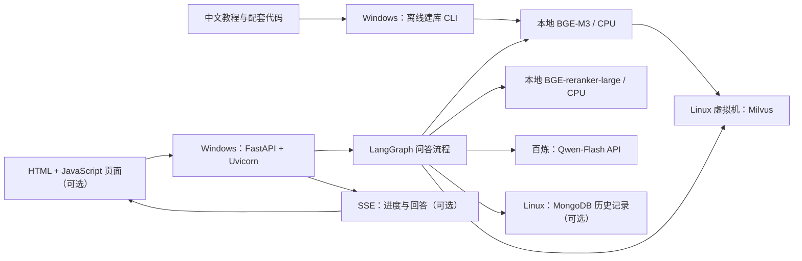
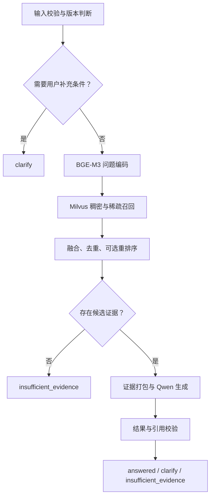

# FastAPI 技术文档助手架构

阶段 2 · 基于现有环境修订 · 2026-11-17

本文描述拟实现的架构，不代表服务已经启动、模型已经加载或评测已经通过。阶段 1 的业务边界和验收标准见 [requirements.md](requirements.md)。阶段 3 已按用户确认整理任务计划，见 [plan.md](plan.md) 与 [AGENTS.md](AGENTS.md)。阶段 4 已搭建基础环境和应用骨架，实测范围见 [环境说明](docs/environment.md)。

## 1. 目标与约束

- 面向开发者，依据固定版本的 FastAPI 官方简体中文教程和配套代码回答中文问题，给出适用条件与可核对引用；信息不足时澄清，无资料依据时明确说明。
- 语料范围固定为 FastAPI 0.135.1 对应提交 `ca5f60ee72f35fb2134d8b5d26bbb75965bcff66` 的 10 篇教程及 64 个示例，具体以 [manifest](corpus/manifest.json) 为准。中文资料与中文问题直接检索，不设置固定翻译节点。
- 项目位于 `D:\S\项目\实战项目\fastapi-rag`。新增项目相关占用不超过 10GB，包含新增依赖环境、缓存、索引、数据库数据、日志及临时文件；已有模型与已有虚拟机基础占用单列，不计入新增额度。共享目录内为本项目新增的数据仍计入。
- 云服务器与模型 API 合计每月不超过 100 元，先测少量实际调用成本。本机虚拟机作为初始部署基础，目前不采购云服务器。
- 保留培训项目的主要编排方式和技术学习价值，按本业务重写数据结构与流程。运行资源、兼容性、质量和费用须经验证。

## 2. 环境证据与待验证边界

以下数据来自用户提供的任务管理器、Xshell 截图，以及本轮之前的本地只读目录检查；是采样时状态，不是运行基准。

| 项目 | 已观察到的事实 | 尚未证明的事项 |
|---|---|---|
| Windows | 24GB 内存，截图时可用约 4.1GB；无 CUDA | 模型加载后的可用内存、CPU 吞吐与延迟 |
| Linux 虚拟机 | 用户配置为 4 核、8GB、40GB 总磁盘；系统显示内存约 7.7GiB、available 5.7GiB，根分区约 39GB、剩余 15GB | RAG 服务启动后的余量；这些余量是在 Milvus 等停止时观察的 |
| 虚拟机网络 | IP 为 `192.168.10.150`，另有 Docker 网桥地址 | Windows 至各服务的连通性、防火墙、重启后 IP 是否变化 |
| Milvus | `milvusdb/milvus:v2.4.11`，容器 `milvus-standalone` 已停止 | 启动健康、现有数据完整性、SDK 与稀疏索引参数兼容性 |
| etcd | `quay.io/coreos/etcd:v3.5.5`，容器 `milvus-etcd` 已停止 | 与当前 Milvus 部署的实际连接配置 |
| MinIO | `minio/minio:RELEASE.2023-03-20T20-16-18Z`，容器 `milvus-minio` 已停止 | 实际存储路径、凭据与桶策略、Milvus 对它的依赖 |
| MongoDB | 镜像标签 `mongo:latest`，容器 `mongo` 已停止 | 准确版本、认证配置、数据健康；latest 不能作为复现版本 |
| MinerU | 截图未出现相应容器；培训仓库配置指向在线 API | 用户提到的本地部署形式与接口，当前流程不依赖它 |
| 其他服务 | MySQL 正在运行，截图约占 402MiB | 属于其他项目，不在本项目中调整 |
| BGE-M3 | `D:\S\zhangguizhiku\BAAI\bge-m3`，约 4.27GiB，存在配置、分词器与 PyTorch/ONNX 权重 | 文件完整性与加载成功尚未验证 |
| 重排序模型 | `D:\S\zhangguizhiku\BAAI\bge-reranker-large`，约 6.28GiB，存在配置、分词器与 Safetensors/PyTorch/ONNX 权重 | 实际采用的权重格式、加载与推理是否正常 |

两套既有模型合计约 10.55GiB，不复制进新项目或虚拟机，不自动删除其他格式。Windows 与虚拟机共享物理内存，两者可用内存不能相加。

## 3. 部署拓扑与连接配置

设计选择：Windows 运行应用与 CPU 模型，Linux 虚拟机承载现有基础服务，百炼提供生成 API。这可以避免在 8GB 虚拟机内同时加载数据库与两套模型；是否足够仍取决于宿主机资源实测。

### 3.1 服务端口与持久化

| 服务 | Windows 侧连接目标 | 已配置的持久化 |
|---|---|---|
| Milvus | `http://192.168.10.150:19530`；9091 为管理/健康相关端口 | `/home/ubuntu_evi/milvus/volumes/milvus` → `/var/lib/milvus` |
| MongoDB | `192.168.10.150:27017`，URI 中认证信息由本地配置提供 | Docker 卷挂载到 `/data/db`、`/data/configdb` |
| MinIO | API：`192.168.10.150:9002`；控制台：`http://192.168.10.150:9003` | Docker 卷 → `/data`；绑定目录 `/home/ubuntu_evi/milvus/volumes/minio` → `/minio_data`；实际使用位置待确认 |
| etcd | 不向 Windows 应用开放连接；应用不直接访问 | `/home/ubuntu_evi/milvus/volumes/etcd` → `/etcd` |

MinIO 宿主机 9002 映射容器 9000，宿主机 9003 映射容器 9001。不能复制培训配置中的 9000 作为 Windows 访问端口。挂载仅证明配置了持久化位置，不证明已有备份或数据完整。

培训仓库当前 .env 的 Milvus、MongoDB、MinIO 指向公网地址，不能当作本地虚拟机配置照搬。它的 MinerU 指向 `https://mineru.net/api/v4`，采用申请上传地址、上传、轮询结果的协议；本地 MinerU 未必兼容。

### 3.2 新项目配置契约

以下是拟采用的变量名与值；这里只描述设计，尚未创建 .env。

| 配置 | 设计值或约定 |
|---|---|
| `MILVUS_URL` | `http://192.168.10.150:19530`，允许按实际 IP 修改 |
| `MILVUS_COLLECTION_PREFIX` | `fastapi_doc_chunks`，按构建版本创建独立集合 |
| `MONGO_URL` | 使用虚拟机地址，认证参数单独填入，不提交凭据 |
| `MONGO_DB_NAME` | `fastapi_rag`，独立于培训项目 |
| `HISTORY_ENABLED` | 历史功能开关，核心单轮问答可独立工作 |
| `MINIO_ENDPOINT` | `192.168.10.150:9002`，SDK 参数不带协议头 |
| `MINIO_BUCKET_NAME` | 若启用业务归档，使用独立桶 `fastapi-rag-corpus` |
| `CORPUS_ARCHIVE_ENABLED` | 首版关闭；本地固定语料可直接建库 |
| `BGE_M3_PATH` | `D:/S/zhangguizhiku/BAAI/bge-m3` |
| `BGE_DEVICE` / `BGE_FP16` | `cpu` / `0` |
| `BGE_RERANKER_LARGE` | `D:/S/zhangguizhiku/BAAI/bge-reranker-large` |
| `BGE_RERANKER_DEVICE` / `BGE_RERANKER_FP16` | `cpu` / `0` |
| `RERANK_ENABLED` | 保留可切换重排能力；默认开启前先过资源与效果验证 |
| 生成模型 | 百炼 `qwen-flash`，地域、API 地址与实际模型标识记录在运行配置中 |

模型目录缺失时明确失败，不静默自动下载大文件。应用模型、缓存、日志路径集中配置到 D 盘；示例环境文件只含占位凭据。

## 4. 技术选型与复用边界

| 技术 | 本次决策 | 理由与边界 |
|---|---|---|
| FastAPI、Pydantic、Uvicorn | 保留，单应用、单 worker 起步 | API 建模、健康检查、静态页面和 SSE；先避免多 worker 重复加载模型 |
| LangGraph + 必要的 LangChain 组件 | 保留 | 显式管理问题、候选证据、分支和结果；LangChain 用于模型与消息接入，不复制整套商品业务 |
| BGE-M3 | 本地 CPU，1024 维稠密表示与稀疏表示 | 复用已有权重与混合检索经验；文档与问题使用同一模型、版本和兼容编码方式 |
| BGE-reranker-large | 本地 CPU，可开关 | 小规模候选重排；用评测比较质量收益与延迟，控制成对输入 token 长度 |
| Milvus | 优先复用现有 v2.4.11 服务 | 替代旧方案的 NumPy 在线向量检索；SDK、索引参数须针对现有服务验证，不直接套培训依赖下限 |
| Qwen-Flash | API 生成中文答案 | 小规模调用计费；参数在评测时固定，默认不引入额外思考流程 |
| Qwen3-VL-Flash | 作为后续图片能力保留，不进入当前必经链路 | 现有正文为 Markdown 和代码，不要求视觉处理，也不额外调用视觉 API |
| MongoDB | 复用服务，历史功能可选 | 存储消息、引用和反馈；保存历史不等于自动获得多轮理解 |
| MinIO | 保留既有基础设施，业务归档可选 | 可能支撑 Milvus 内部存储；不因应用无图片而停掉。业务不默认上传全部原件 |
| MinerU | 当前不接入 | Markdown 直接解析；未来有 PDF 再核对本地 API 和资源 |
| HTML + JavaScript + EventSource | 保留设计，核心问答通过后可选实施 | 展示问题、阶段进度、引用与完成结果；核心非流式接口仍用于自动评测 |

培训项目可借鉴客户端适配、模型懒加载、稠密/稀疏检索、流程与业务分层、SSE 和按阶段计时。不可直接照搬商品确认与 item_name 过滤、按商品删旧数据、图片公开桶策略、HyDE/WebSearch 必经流程或全部重型依赖。

首版采用单次混合召回与可选重排。HyDE、WebSearch 不进入默认流程，以固定语料为证据边界。旧设计中的远程 text-embedding-v4、NumPy 主索引、bge-small 备选均退出本版默认架构；后续若 CPU 资源验证不通过，再比较替代方案并单独确认。

## 5. 离线建库流程与数据契约

1. 校验 manifest、固定提交、Git blob 哈希与许可证。仅读取清单中的原件与示例，路径限定在 corpus/raw，评测答案不入库。
2. 解析 Markdown 标题、段落、提示块、代码围栏及 FastAPI 示例包含指令；按标记关联 Python 示例，保留选行范围。图片标签不当作已理解的图片内容。
3. 按语义章节切块，代码优先保持完整；较长代码建立关联片段。长度以实际分词结果检查，为重排序的“问题＋片段＋特殊符号”留出空间。512 token 作为初始重排输入预算，经实际 tokenizer 和模型配置核对，不等同于 512 字。
4. 生成稳定 chunk_id，保存来源和内容指纹。批量调用本地 BGE-M3 产生 dense、sparse；批大小先小后测，建库与问答错峰运行。
5. 建立新版本集合，插入片段与向量，核对条数、维度、抽样来源、查询能力后切换活动索引指针。构建失败保留旧活动索引；不覆盖培训集合。
6. D 盘 data/index/ 保存 chunks.jsonl、index-meta.json 和活动版本清单，用于审计和重建；Milvus 是在线向量检索主存储。若缓存向量以避免重算，缓存有明确版本、保留数及新增空间计量。

每个片段至少包含：

| 字段组 | 内容 |
|---|---|
| 身份 | chunk_id、document_id、content_hash、build_id |
| 正文 | text、heading_path、content_type（说明或代码）、关联片段 ID |
| 来源 | source_path、line_start、line_end、固定提交 source_url、官方中文页面链接 |
| 版本 | source_commit、knowledge_version、parser_version |
| 模型与检索 | dense_vector、sparse_vector；模型版本、维度和编码配置记录于构建元数据 |

建议稠密字段采用 FLOAT_VECTOR(1024)、稀疏字段采用 SPARSE_FLOAT_VECTOR，距离及索引与模型输出保持一致。最终索引类型和参数需在 Milvus v2.4.11 上验证；不预设培训代码中的 DAAT_MAXSCORE 或其他参数在本机一定可用。

切换模型、分词或处理规则后创建新构建版本。复用服务不复用培训项目的集合与索引内容。集合存在不能直接视为 schema 正确，启动须检查字段和模型元数据。

## 6. 在线问答流程

LangGraph 状态携带 request_id、session_id、问题、附带代码或报错、目标版本、知识版本、候选片段、重排结果、引用、结果状态、阶段耗时及费用，不在状态中保存密钥。

- 原始代码标识符、错误文本和 HTTP 状态码保留；提问编码与建库编码保持一致，分别调用对应的 query/document 编码接口并验证输出形状。
- 候选规模初始可设为稠密、稀疏各 10 条，融合去重后最多 10 条送重排，再选约 3～5 条证据；均为待调参数，不是验收结果。
- 稠密与稀疏结果采用明确的融合策略。先用 RRF 融合两种排名，避免直接相加不同量纲分数；如改用加权评分，则说明归一化并做对照。培训项目的 0.9/0.1 权重仅作参考。
- 无召回直接说明资料不足；有候选时结合问题条件与证据判断，不把高相关性分数当作答案必然存在。证据分数阈值只能用开发题校准。
- 长候选通过切块或可追踪窗口处理，不默认调用大模型摘要再重排，避免额外费用及代码条件丢失。
- 生成返回结构化结论、引用 ID 及 answered、clarify、insufficient_evidence 之一。技术故障使用独立错误状态，不能冒充“知识库没有答案”。
- 引用只允许来自实际送入模型的证据，由服务端元数据组装链接、标题、版本和行号。核心事实是否受引用支持仍需人工评测；ID 合法不代表语义正确。
- 确认目标版本不在当前语料范围时提示覆盖范围；不宣称其他版本兼容。
- MongoDB 历史可用于展示。首版不默认把全量历史注入模型或进行无界多轮推理；如加入指代改写须单独定义输入、费用与评测。

## 7. API、SSE 与失败行为

阶段 3 已确认：页面与 SSE 在核心问答通过后作为可选任务，具体见 plan.md 的 T07/T08。核心首版通过接口文档或命令演示；下述任务接口、事件回放和页面行为仅在选择实施时验收，保留设计不代表已经实现。历史与业务归档也保持可选。

| 接口 | 约定 |
|---|---|
| GET /health | 进程存活；不触发模型下载或付费 API |
| GET /ready | Milvus 活动集合/配置、必需模型加载状态；历史开关开启时报告 Mongo 状态。区分必需依赖和可选依赖 |
| POST /query | 非流式，供调试和评测。输入 question、可选 context、target_version；返回 status、answer、citations、knowledge_version、request_id |
| POST /query/jobs | 可选：创建网页问答任务，返回 request_id 与事件订阅地址 |
| GET /query/jobs/{request_id}/events | 可选：EventSource 订阅 SSE，事件包括 progress、result、error、done |
| GET /history/{session_id} | 历史功能开启时返回会话记录 |

原生 EventSource 使用 GET 订阅，不直接发送 POST JSON。非流式与流式入口复用同一问答服务，不能维护两套答案逻辑。

为保证引用校验，首版 SSE 先实时输出阶段进度，答案生成并校验后以 result 发布；网页可以分段展示，但不得把整段生成后的播放称为模型 token 实时流。真正 token 流作为后续可选增强，需处理未校验草稿、取消与失败状态。

任务存储先使用单进程内存、限制数量与有效期，支持存活期间的重连事件回放。服务重启后旧任务明确返回失效，不假装已持久恢复。EventSource 重连只订阅既有任务，不重复调用生成 API；前端收到 done 后关闭连接。

CPU 模型调用不得直接长时间阻塞异步事件循环。采用受限执行队列/线程执行同步推理，初始一次处理一个问答；加载、入库与推理加并发约束。模型单例仅在单个进程内有效，不代表跨 worker 共享。

Mongo 不可用时，历史接口明确报告不可用；单轮问答是否可继续由历史开关和依赖策略决定。MinIO 业务归档关闭时不是独立问答依赖，但若 Milvus 底层使用它，其故障仍会间接影响检索。

## 8. 模块布局

以下为目标布局。阶段 4 已创建基础包和健康接口，业务图、节点、服务与适配器随任务实现。具体环境与已交付入口见 [环境说明](docs/environment.md)。

| 位置 | 职责 |
|---|---|
| app/api/ | FastAPI 入口、Pydantic 模型、查询/任务/SSE/健康接口 |
| app/process/ | LangGraph 图、状态、任务生命周期及分支 |
| app/rag/ingest/ | 清单校验、Markdown 与代码关联、切块、构建版本 |
| app/rag/query/ | 召回融合、重排、证据打包、引用与边界判定 |
| app/infra/models/ | BGE 加载与编码、重排、Qwen API 适配 |
| app/infra/storage/ | Milvus、MongoDB、可选 MinIO 的访问封装 |
| app/shared/ | 配置、日志、费用与耗时记录、通用错误 |
| app/resources/prompts/ | 提示词及其版本 |
| app/web/ | HTML、JavaScript、引用展示和 EventSource 客户端 |
| corpus/ | 固定输入、许可证、清单；不存模型副本 |
| evaluation/ | 开发题、独立验收题、评分与对照报告 |
| data/index/、data/reports/、logs/ | 可重建产物、构建元数据、测量记录与受控日志 |
| docs/ | 数据调研和后续复现说明 |

应用使用独立 Python 环境。Python 版本及依赖组合在兼容性验证后锁定，优先评估已有 Python 3.12；不整份复制培训 pyproject.toml。当前无需本地 PDF/视觉解析栈，不默认引入 magic-pdf、MinerU 运行模型、torchaudio、torchvision 等未被实际使用的依赖。CPU PyTorch 与模型依赖以真实导入要求为准。

## 9. 空间、资源与费用

### 9.1 新增占用口径

用户已确认：10GB 指新增占用，既有两套模型约 10.55GiB 与既有虚拟机基础占用不纳入新增额度，但单独列示。具体计量同时记录字节与 GiB，避免 GB/GiB 混用导致超额。

- 实施前建立基线：D 盘项目、共享模型与缓存目录、Linux 数据卷和宿主机虚拟磁盘的实际占用。
- 本项目新增的虚拟环境、包下载缓存、模型补充文件、Milvus/Mongo/MinIO 数据、日志和临时文件均计入，即使位于项目目录外。
- 虚拟机内部数据增长用于定位来源；对应宿主机虚拟磁盘增长单独核对物理空间，避免同一份数据双重计数。
- 不重复下载或复制模型，不自动清理既有模型、其他业务数据或共享缓存。构建和依赖安装前估算，完成后测量；大文件操作超出剩余额度则停止并调整方案。
- 40GB 是虚拟机总磁盘，并非剩余空间。截图可用 15GB 仅为当时状态，依赖、索引与日志增长后需复查。

### 9.2 资源与成本控制

Windows 截图仅剩约 4.1GB 可用内存，是当前风险点。两套模型同时加载的峰值和推理临时内存必须实测，不按模型磁盘大小直接推算 RAM。先单 worker、低批量、串行验证、导入与问答错峰；不默认增加虚拟机内存或调整其他项目。

本地 BGE 编码和重排不产生外部模型 API 账单，但消耗本机资源。费用台账仍计入 Qwen 生成、评测、重试以及未来任何付费基础设施，合计不超过 100 元/月。删除旧方案依赖远程 embedding 的单次费用估算，按实际账户地域、模型计价和 token 用量重新采样。

调用前按输入与输出上限预留费用，完成后按实际用量核销；限制重试次数，接近预算时停止新的付费请求。未知用量保守记录并对账。先低调用量测成本，再安排评测，不承诺免费额度或固定单价。

演示默认限本机/受控局域网；供应商密钥只在服务端。若以后公开问答接口，再落实鉴权、配额和限流，不直接暴露数据库或 MinIO 管理端口。

## 10. 验证与阶段边界

以下是设计验收维度，不是阶段 3 的任务拆分或已执行结果。

1. 环境：核对容器启动依赖、MinIO 实际数据路径、Mongo 准确版本、端口连通与认证；在新集合/数据库上验证，避免修改培训数据。
2. 模型：使用现有路径验证加载、稠密与稀疏输出、重排分数、冷启动/热启动耗时和峰值内存；记录实际模型文件标识。
3. 兼容：验证现有 Milvus v2.4.11 与锁定 SDK、字段、索引、混合查询和构建切换的组合；若不兼容先调整客户端/参数，不自动升级共享服务。
4. 效果：先使用 20 道开发题；对比稠密检索、稠密＋稀疏融合、增加重排的证据命中与耗时，并以同一生成模型比较直接回答与 RAG。
5. 最终验收：独立 20 题在调参前冻结；16 道有据题至少 13 道严格通过，4 道边界题全部通过，沿用 [评分口径](evaluation/sample-review.md)。
6. 接口：核心非流式问答的结果、引用和技术错误有明确行为；若启用页面/SSE，再验收两种入口最终结果一致、断连重连与任务失效处理，重连不触发重复付费。
7. 复现：固定语料可重建，重启后可加载有效索引，至少演示一个有据回答和一个澄清/资料不足案例。
8. 约束：实测新增占用不超过 10GB、月度费用不超过 100 元。延迟目标依据初测确定，不提前承诺响应秒数。

阶段 2 当前结论：架构按复用本机虚拟机与现有 CPU 模型设计；运行可行性、兼容性与性能待验证。本文件不授权启动或改动现有共享服务。用户已确认进入阶段 3，任务与协作规则见 [plan.md](plan.md)、[AGENTS.md](AGENTS.md)。阶段 4 已完成基础环境和骨架的初步检查，核心模型、索引和问答仍待验证。

## 11. 设计依据

- 本地培训仓库：`D:\S\项目\掌柜智库\智库代码`，只读参考。模型加载见 app/shared/model/embedding_utils.py、reranker_utils.py；混合检索见 app/shared/clients/milvus_utils.py 与 app/rag/query/search_embedding_service.py；索引见 app/rag/import_/index_service.py。
- 培训项目的重排摘要、商品过滤与覆盖导入均含原业务假设，新项目不直接复制；MinerU 在线协议见 app/rag/import_/pdf_parse_service.py；MinIO 图片上传及桶策略见 app/rag/import_/markdown_image_service.py 与 app/shared/clients/minio_utils.py。
- 官方资料：[BGE-M3](https://huggingface.co/BAAI/bge-m3)、[BGE-reranker-large](https://huggingface.co/BAAI/bge-reranker-large)、[LangGraph](https://docs.langchain.com/oss/python/langgraph/overview)、[FastAPI SSE](https://fastapi.tiangolo.com/tutorial/server-sent-events/)、[Qwen-Flash](https://help.aliyun.com/zh/model-studio/qwen-flash)。能力说明不替代本机锁定版本的测试。
